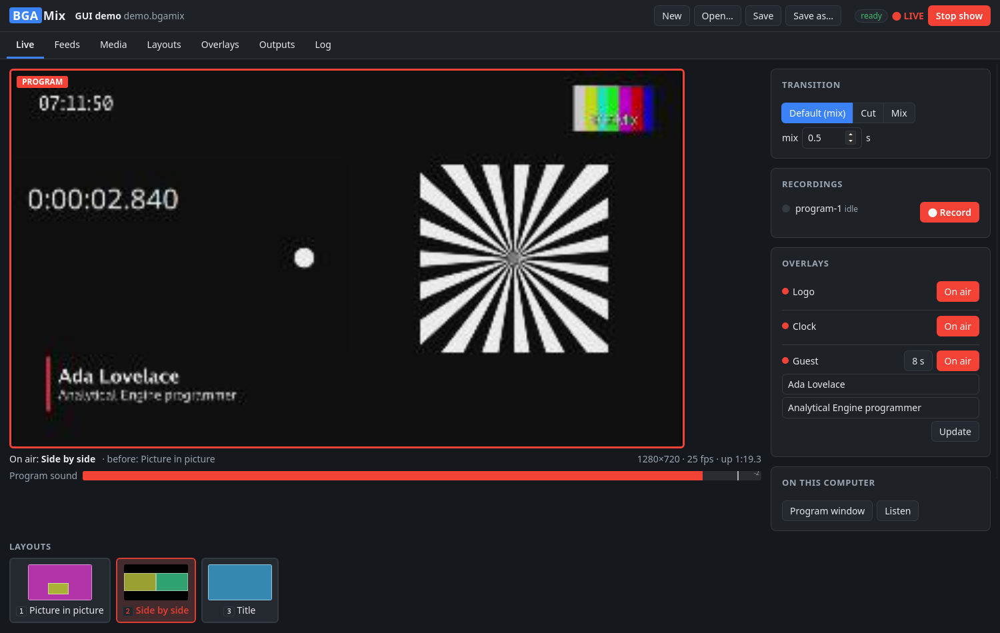
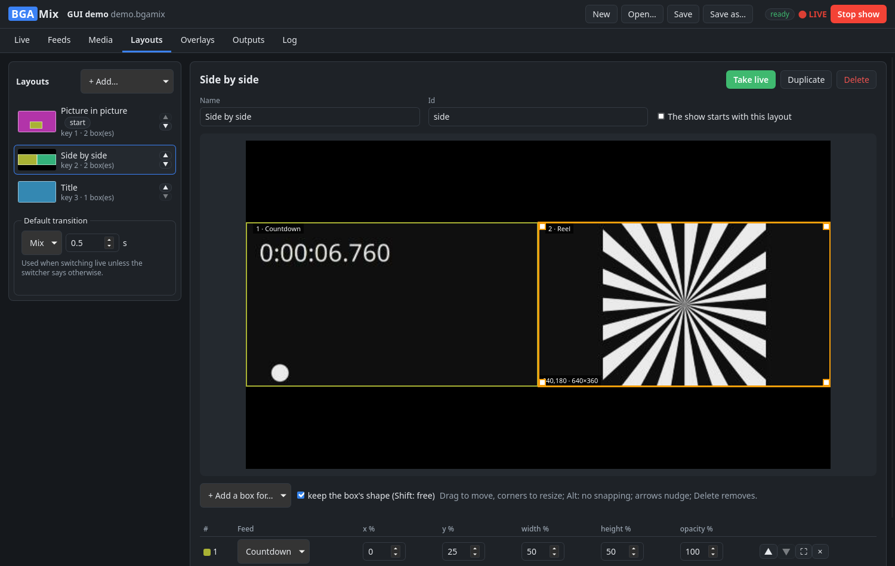
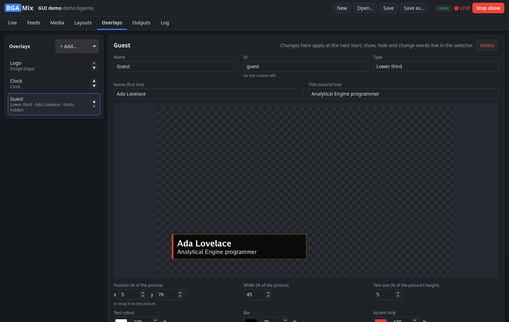
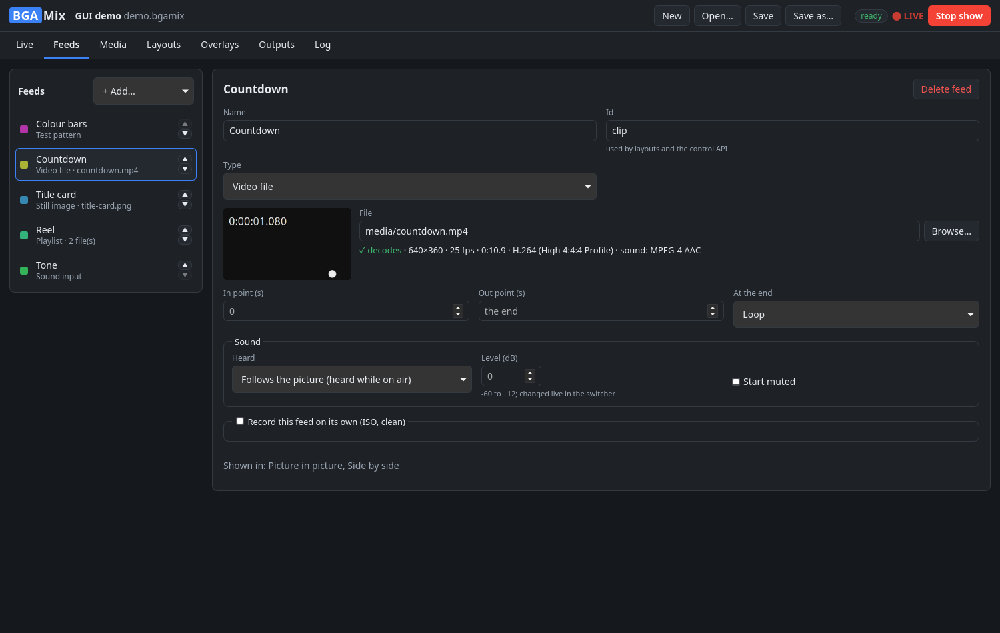

# BGAMix

A live video mixer you set up and run from a GUI instead of scripts. BGAMix takes cameras,
network streams, video files, images and sound inputs as feeds, places them in layouts (full
screen, picture in picture, side by side, grids, your own), switches between layouts live with
cuts and mixes, puts titles, logos, clocks and lower thirds over the picture, mixes the sound,
and records and streams the result. It runs on a desktop, a server or a small box, from its
desktop window, a web browser, or remotely through its control API.



## Features

- **Feeds:**
  - USB webcams and capture cards;
  - network streams (SRT, RTSP, UDP, RTMP, HLS), reconnected automatically when they drop;
  - video files with in and out points, looping, holding or returning to the cameras at the end;
  - playlists, still images, test patterns, microphones and line inputs.
- **Layouts:** drawn on a canvas the shape of the picture; drag and resize boxes, with snapping.
  Switch live with a click or keys 1–9, by a cut or a timed mix.
- **Overlays:** lower thirds (change the name live, show for 8 seconds), text, a clock, and logos
  with transparency, each fading in and out and shown on chosen layouts.
- **Sound:**
  - a meter, fader and mute per feed and for the program;
  - sound that follows the picture (heard while the feed is on air, crossfaded on mixes) or
    stays on.
- **Recording:**
  - MP4 (crash-safe: a power cut leaves a playable file), MKV or MOV, in H.264 or H.265;
  - pause and resume, split into files by time or size;
  - clean recordings of single feeds (ISO).
- **Streaming:** RTMP/RTMPS (YouTube, Twitch, Facebook …) and SRT, reconnecting by itself.
- **Hardware encoding** where available (VA-API, NVENC, Quick Sync), otherwise x264/x265.
- **Control:** the desktop window, any web browser, or an HTTP/WebSocket API (with a token for
  remote use) for your own buttons, scripts and stream decks.

| Layouts | Overlays | Feeds |
|---|---|---|
|  |  |  |

## Get started

1. **Install** BGAMix and GStreamer: see [docs/install.md](docs/install.md).
2. **Start it:** `bgamix-gui`, or `bgamix serve` for the GUI in your browser.
3. **Learn it:** the [user guide](docs/guide.md) walks through feeds, layouts, overlays, the
   switcher, sound, recording and streaming.

To remote-control a show or build your own panel, see the [control API](docs/api.md).

From the source (Go 1.26 or newer; GStreamer development packages, see the install guide):

```
go build -o bgamix ./cmd/bgamix
go build -tags desktop,production,webkit2_41 -o bgamix-gui ./cmd/bgamix-gui
go test ./...        # runs shows, decodes their recordings and checks the pixels and the sound
```

## How it works

BGAMix is written in Go and uses [GStreamer](https://gstreamer.freedesktop.org/) as its media
engine. Each feed runs in its own pipeline, so a camera that drops out or a stream that stalls
never stops the mix; BGAMix reconnects it. The mixer composites the feeds, and layouts and
transitions change the picture live without restarting anything.

## Inspired by Snowmix

BGAMix is inspired by [Snowmix](https://snowmix.sourceforge.net/) by Peter Maersk-Moller, a
live video mixer driven by scripts, which showed what such a tool can do. BGAMix is a separate
program written from scratch: it contains no Snowmix code, scripts, configuration, documentation
or media, and it has its own project format, layout model and control interface. It aims at
people who would rather click than script. If Snowmix's scripting suits you, use Snowmix.

## Licence

MIT (see [LICENSE](LICENSE)). BGAMix uses GStreamer (LGPL-2.1, dynamically linked system
libraries) through MIT-licensed Go bindings; every dependency is listed with its licence in
[THIRD-PARTY.md](THIRD-PARTY.md).
